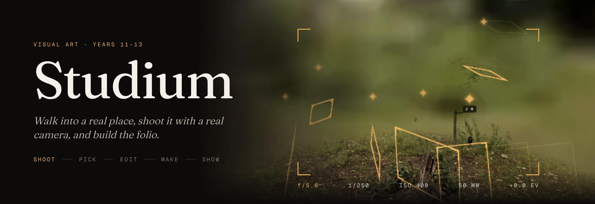
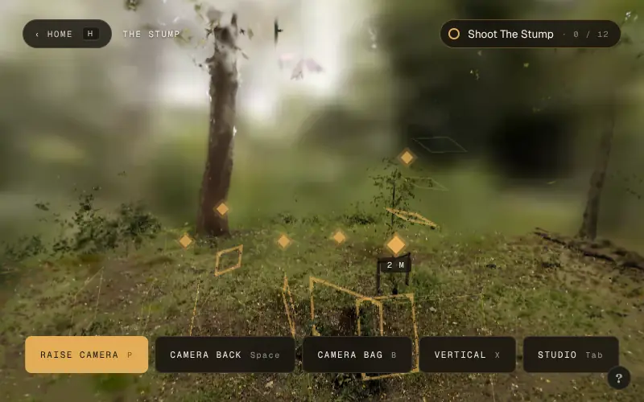
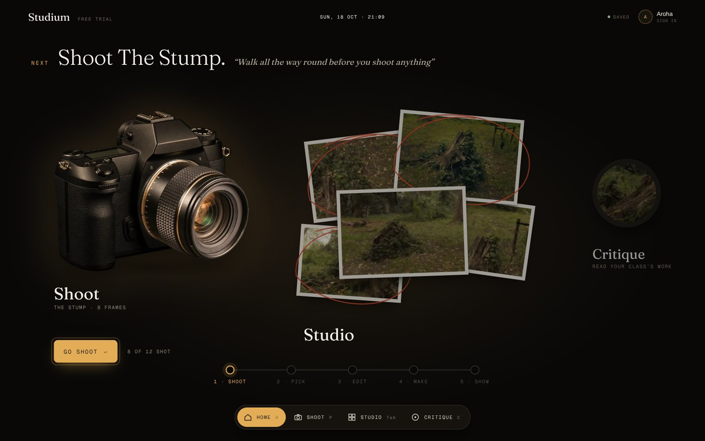
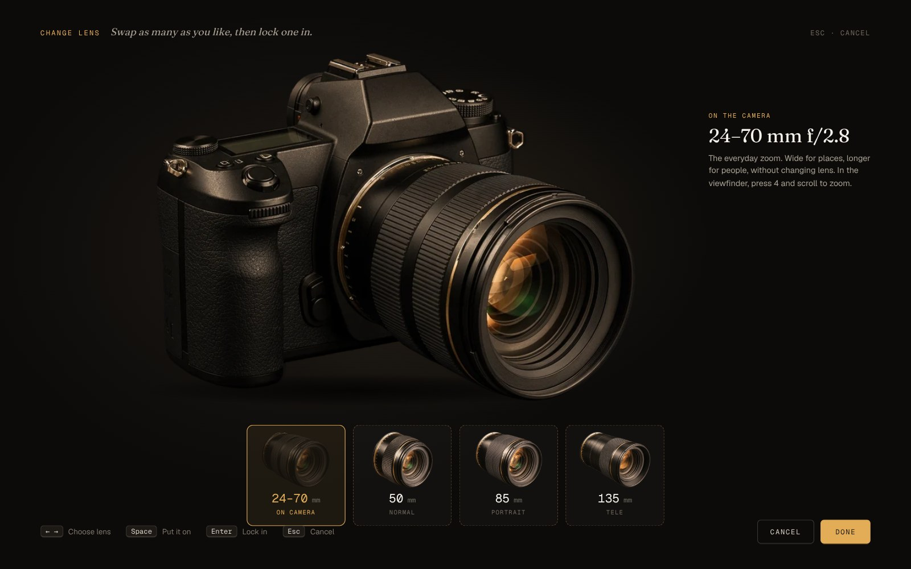
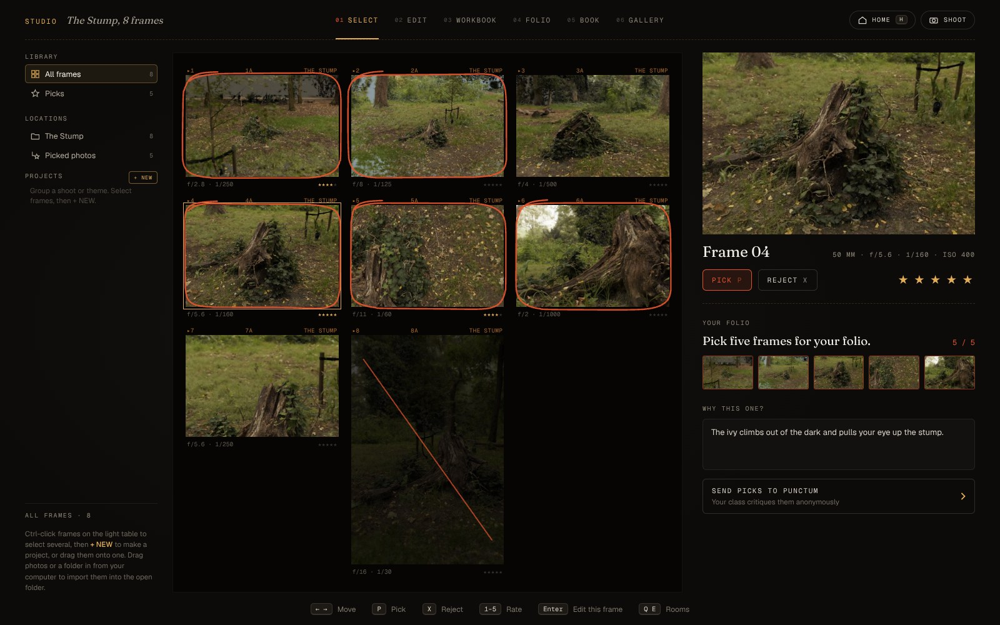
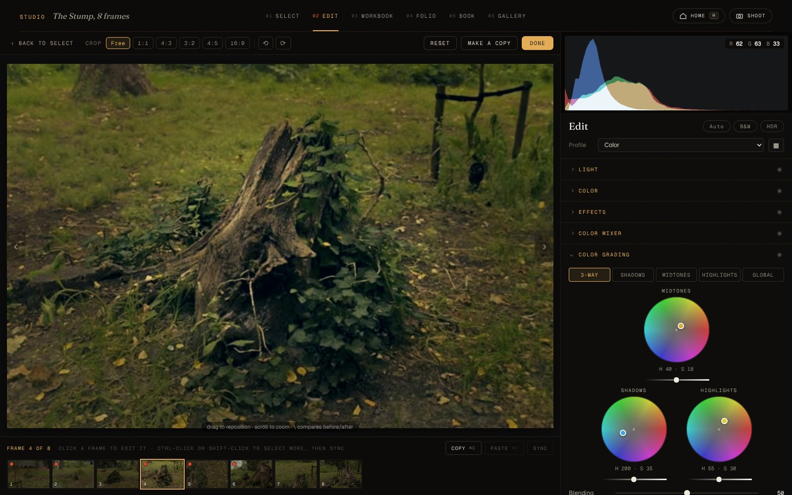
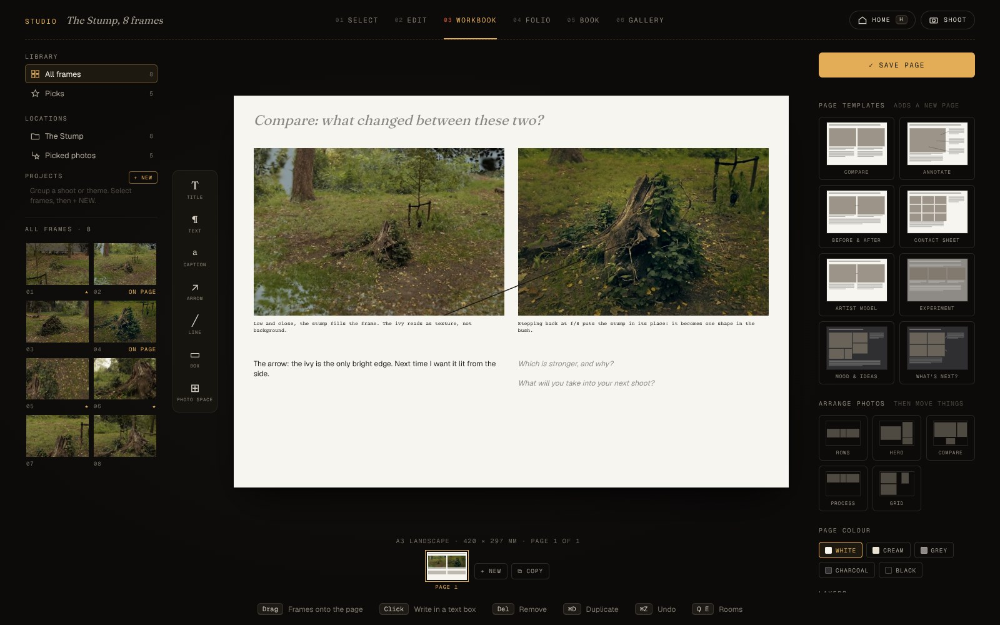
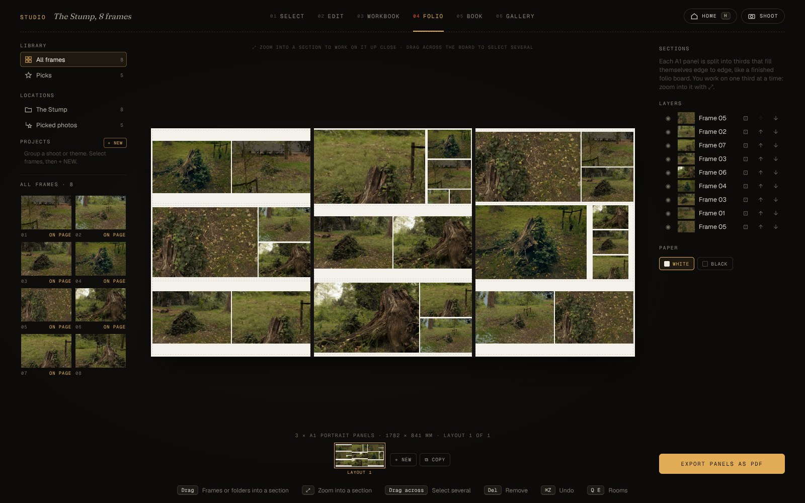
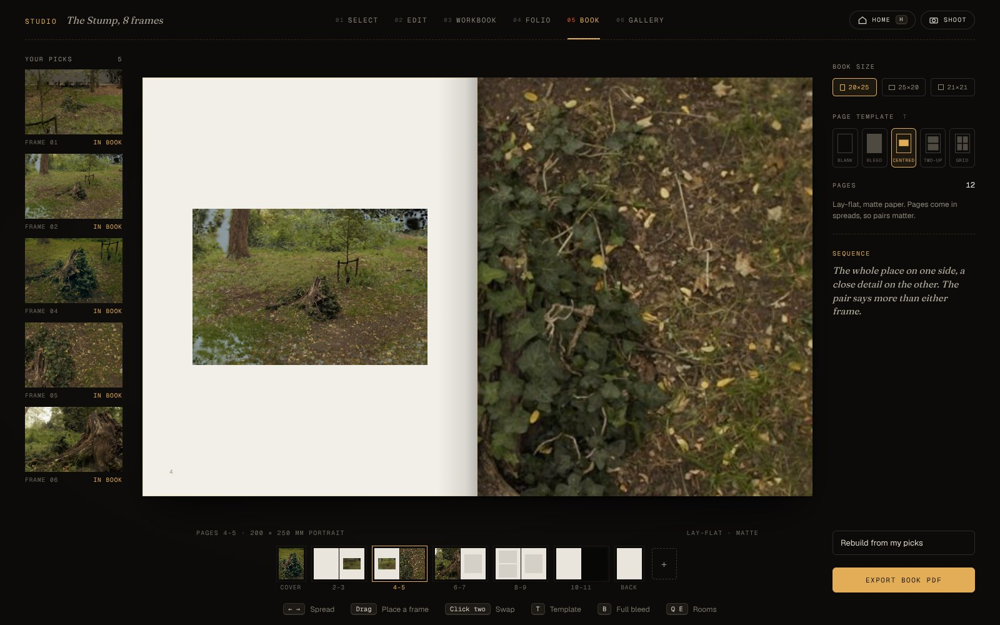
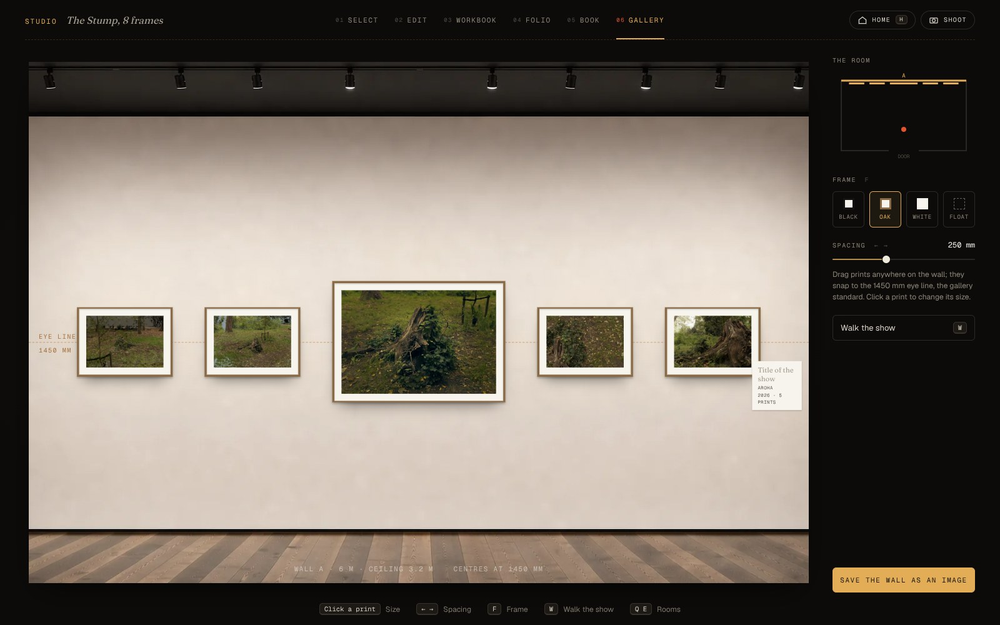

<p align="center">
  
</p>

<p align="center">
  
  
  
  
</p>

<p align="center">
  <b><a href="#try-it">Try it</a></b> •
  <b><a href="#put-it-online">Put it online</a></b> •
  <b><a href="#build-from-source">Build from source</a></b> •
  <b><a href="#a-lesson-in-studium">A lesson in Studium</a></b> •
  <b><a href="#how-its-made">How it's made</a></b>
</p>

<p align="center">
  
  <br><sub><i>The Stump, a real place scanned as Gaussian splats. The gold frames are challenges: walk into one and the shot lines itself up.</i></sub>
</p>

**Studium is a photography studio that runs in a browser tab.** Students walk through a Gaussian-splat scan of a real place,
shoot it with a simulated camera that behaves like the real thing (aperture, shutter, ISO, focal length, depth of field,
handheld shake, crop factor, film grain), then cull, develop, lay out and hang their work. That covers the whole NZ Visual Art
(Photography) workflow for Years 11–13, all in one HTML file with nothing to install. **Punctum**, its companion critique game,
lives inside it.

## Features

- **Real places, not stock photos.** Scenes are Gaussian-splat scans you can walk around, with collision, ground-following
  and a sky dome built from the scan itself. Three detail levels (Light, Balanced, Full) keep it smooth on school laptops.
- **A camera that teaches.** Raise the camera (right click or `P`) for a true-FOV viewfinder; the scroll wheel zooms a
  zoom lens. Flip to the back (`Space`) for shutter, aperture and ISO as sliders you click or drag, the meter, and a
  Review tab. Stand in a gold frame and its checklist comes onto the back with you. Shutter speed causes real handheld blur, aperture sets real depth of field, and `X` turns
  the camera vertical.
- **A camera bag.** Three bodies (full-frame DSLR, APS-C mirrorless at 1.6×, a 6×7 film SLR on a ten-frame roll), each
  with its own lenses, from a 24–70 zoom to a 165 mm on the 6×7, plus an animated lens swap.
- **Gold-frame challenges, Skate-style.** Briefs float in the scene as glowing frames: *Shallow depth of field*,
  *Silhouette*, *Telephoto detail*, *Medium format, vertical*. Walk into the pulse and it pulls you into position. Then
  it's up to you to nail the settings.
- **Research.** Punctum, rebuilt inside the studio. Artist packs from your Punctum account: the Punctum round (does
  anything prick you? tap the detail, say why) and the Culling Game (two at a time to a top three), with what the class
  thought, and one click turns a photograph and your notes into an Artist model page.
- **Select.** A light table with pick (`P`), reject (`X`), stars, notes on *why this one*, folders, projects and
  drag-and-drop import from the computer (EXIF included).
- **Develop, on a real Camera Raw engine.** A JavaScript port of PhotoCraft's pipeline runs in Web Workers:
  Highlights/Shadows as a local Laplacian filter, measured Whites/Blacks curves, Dehaze, Clarity, Texture, an HSL **Color
  Mixer** and 3-way **Color Grading** wheels, a proper **crop tool** (handles, free or fixed ratios, rule of thirds) and a
  Before / After button. Previews show the full stage at full sharpness, and full-size renders bake in the background.
- **Workbook.** A3 pages with templates made for the NCEA workbook: Rank, Compare, Annotate, Before & after, Contact
  sheet, Artist model, Experiment, Mood & ideas, What's next? It also has arrows, captions, layers and page colours.
- **Folio.** Three A1 portrait panels, worked one third at a time. Drop photos in (repeats allowed) and each third fills
  edge to edge with no white space, photos cropping a little to fit. Click **SIZE** on a photo to make it bigger; try
  Rows, Columns or Hero; **Shuffle** deals a new arrangement. Exports to PDF.
- **Book and Gallery.** A lay-flat photobook with spreads and page templates, and a gallery wall at real print sizes on
  the 1450 mm eye line: hang photos from the library, take them down, choose frames, and a title card you can restyle
  and drag anywhere.
- **Lessons and teachers.** A teacher timeline, a live class view, heads-up and move-on cards, and a hub that walks each
  student through Shoot → Pick → Edit → Make → Show.
- **Learn by doing.** A game-style warm-up (WASD, look, raise, bag, then each camera setting with a little clip of what
  it does) unlocks the gold frames. After that, hands-on tours run through every room: on one photo you drag each
  slider to a gold mark, then edit your own way. Popups wait a few seconds before they can be dismissed, so they get
  read. There's a **ten-minute demo** for playtesters.

## A lesson in Studium

<table>
  <tr>
    <td width="50%"><br><sub><b>Home.</b> Today's brief, your kit and where you're up to.</sub></td>
    <td width="50%"><br><sub><b>Camera bag.</b> Choose a body, swap lenses, lock one in.</sub></td>
  </tr>
  <tr>
    <td><br><sub><b>Select.</b> Pick, reject, rate and say <i>why this one</i>.</sub></td>
    <td><br><sub><b>Edit.</b> Camera Raw sliders, Color Mixer and Color Grading wheels.</sub></td>
  </tr>
  <tr>
    <td><br><sub><b>Workbook.</b> The Compare template, with an arrow onto one detail.</sub></td>
    <td><br><sub><b>Folio.</b> Three A1 panels, each third packed edge to edge.</sub></td>
  </tr>
  <tr>
    <td><br><sub><b>Book.</b> Spreads, sequence and page templates.</sub></td>
    <td><br><sub><b>Gallery.</b> Hang the show at real sizes, on the eye line.</sub></td>
  </tr>
</table>

## News

- **19 Oct 2026.** Playtest round: the viewfinder wheel just zooms; the camera back is sliders, and carries a
  challenge's checklist; bigger popups that wait to be read; a bigger loupe and pick five; the edit tour slider by
  slider to gold marks, then your own edit with copy and paste; a real crop tool; a Rank workbook page; folio thirds
  with no white space and a size button; the gallery gets a library and a movable title card. The sign-in page is just
  the demo for now.
- **18 Oct 2026.** Hands-on tours for every room: Select, Edit (light, black and white, crop, grading), Workbook, Folio,
  Book, Gallery. They end with *go and shoot your own*. The folio is now one third at a time, with Shuffle. New workbook
  templates.
- **18 Oct 2026.** A ten-minute **demo** from the sign-in page for playtesters. A game-style warm-up before the gold
  frames. **Balanced** scan detail. A web build for hosts with a per-file limit.
- **17 Oct 2026.** Develop moves to a **Camera Raw engine** ported from PhotoCraft, with Color Mixer and Color Grading.
  Drag-and-drop import into the library.
- **17 Oct 2026.** Library folders and projects, self-filling folio sections, handheld camera shake.
- **16 Oct 2026.** Gold viewfinder-frame challenges, walking on the ground, a sky dome from the scan, and the Stump at
  full detail.
- **16 Oct 2026.** The Studio rooms (Select, Edit, Workshop, Folio, Book, Gallery), the camera bag and the camera back.

## Try it

Download **`studium.html`** from [Releases](../../releases) and open it in Chrome or Edge. It runs straight from the file,
with no server and no install. Choose **Play the demo** on the sign-in page for the ten-minute version, or add `?demo` to
the address (`studium.html?demo`, or `https://your-site/?demo`) to send playtesters straight into it. The sign-in page only offers the demo for now. Add `?full` to get school
sign-in, class codes and the teacher view back.

## Put it online

`npm run build:web` makes `dist/web/`: a 4 MB `index.html` plus the scan split into pieces under 8 MB. The pieces are
fetched and joined when the scene opens, about 37 MB in all. Drag the folder, or a zip of it, onto
[Netlify Drop](https://app.netlify.com/drop) or any static host. `npm run serve` tries it locally at
http://localhost:8080/.

## Build from source

```bash
npm install
npm run build        # -> dist/studium.html, one self-contained file
npm run build:web    # -> dist/web/, for static hosts
npm test             # build, then the headless test suite (screenshots in tests/out/)
node tools/shots.mjs && node tools/shots.mjs walk && python3 tools/walk.py   # README images
```

Open `dist/studium.html` in Chrome. Add `?dev` to expose the test hooks (`window.__cb`, `__ed`, `__dev`, `__ch`, `__co`).

| Needs | Why |
|---|---|
| Node 18+ | `build.mjs` and the tests |
| Playwright + Chromium | the headless tests (they render the scan with SwiftShader, so they are slow) |
| A WebGL2 browser | Chrome or Edge on a school laptop is the target |

## How it's made

| Path | What it is |
|---|---|
| `src/index.html` | Page shell: all markup. `@@include x@@` lines pull in the files below. |
| `src/styles/main.css` | The whole stylesheet. The darkroom tokens live in `:root`. |
| `src/app.js` | The app: movement, camera sim, menu, editor, save/resume, and the include list for the rest. |
| `src/engine.js` | Entry for three.js + @mkkellogg/gaussian-splats-3d, bundled by esbuild. |
| `src/research.js` | Research: Punctum's packs from Supabase, the Punctum round, the Culling Game, into the workbook. |
| `src/crop.js` | The crop tool: a box over the whole photo with handles, ratios and a thirds grid. |
| `src/crdev.js`, `src/crtables.js` | The Develop engine, a port of PhotoCraft's Camera Raw pipeline, run in Web Workers, plus its measured curve tables. |
| `src/edpanels.js` | Color Mixer and Color Grading panels. |
| `src/studio.js`, `src/board.js` | The Studio rooms; the Workbook and Folio boards and their templates. |
| `src/challenge.js` | Gold-frame challenges and the pull into position. |
| `src/guide.js`, `src/coach.js` | The first-session guide, the demo, and the hands-on tours. |
| `src/lesson.js`, `src/hub.js`, `src/sync.js` | Lessons, the hub and sign-in, and the optional Supabase sync. |
| `src/import.js` | Drag-and-drop import with EXIF. |
| `assets/` | Fonts, camera renders, scene `.splat` files and thumbnails. |
| `vendor/punctum.html` | The Punctum build, maintained in its own project. Drop a newer one here to update it. |
| `build.mjs` | Assembles everything into one HTML file, or the split web build, and syntax-checks every inline script. |
| `tools/` | Local server for the web build, and the README screenshot script. |

In any source file, `asset:path/to/file` becomes a base64 `data:` URI, and `asset-b64:path/to/file` becomes the bare
base64. Paths are relative to the repo root.

**Pinned engine.** `three@0.160.0`, `@mkkellogg/gaussian-splats-3d@0.4.7` and `esbuild@0.24.2` rebuild the original
engine byte-for-byte. Upgrade them on purpose, never by accident.

**Adding a scene.** Put `name.splat` and `name-thumb.jpg` in `assets/scenes/`, then add an entry to `src/scenes.js`
with `thumb:"asset:assets/scenes/name-thumb.jpg"` and `data:"asset-b64:assets/scenes/name.splat"`.

**Rebuild plan.** See `docs/rebuild-brief.md`. The decisions so far:
- keyboard and mouse first;
- Supabase (Sydney) for class logins and data;
- a Review tab on the camera back;
- mockups before code.

## Credits

- [three.js](https://threejs.org) and [GaussianSplats3D](https://github.com/mkkellogg/GaussianSplats3D) render the scans.
- The Develop engine is ported from PhotoCraft (MIT, see `licenses/`).
- Type is [Fraunces](https://fonts.google.com/specimen/Fraunces), [Geist](https://vercel.com/font) and Courier Prime,
  all under the SIL Open Font License.

## Trivia

- The names come in a pair from Roland Barthes' *Camera Lucida* (1980). The *studium* is the general interest a photograph
  holds: its subject, its context, what it's about. The *punctum* is the detail that pricks you. Studium is where students
  make the work, and Punctum is where the class critiques it.
- Every screenshot on this page is from the real app, rendered headless by `tools/shots.mjs`.

## About

Made in Aotearoa New Zealand by **Sam Quinn**, Visual Art teacher and photographer.
